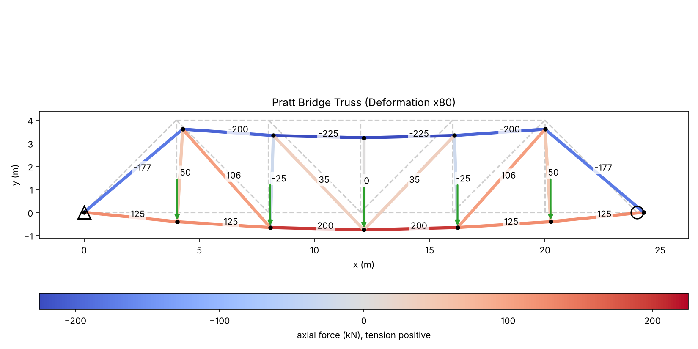
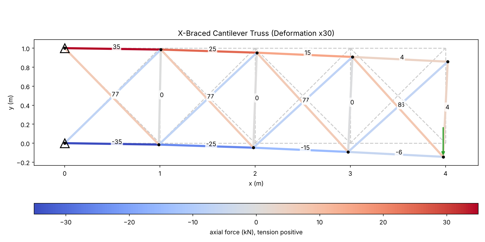

# Truss FEM Solver


Linear-elastic 2D truss solver using the direct stiffness method. Computes nodal displacements, member forces and stresses, and support reactions, including for statically indeterminate trusses. Trusses are defined in JSON; results are printed and plotted with members colored by axial force.



## Validation

| Case | Analytical | Solver |
|---|---|---|
| Pratt bridge reactions | 250 kN / 2 = 125 kN | 125.00 kN |
| Bottom chord 2-3 (method of sections, moments about node 8) | (125·8 − 50·4) / 4 = 200 kN | 200.00 kN |
| Top chord 8-9 (method of sections, moments about node 3) | −(125·12 − 50·4 − 50·8) / 4 = −225 kN | −225.00 kN |
| Center vertical 3-9 | zero-force member | 0.00 kN |
| Three-bar indeterminate truss, vertical bar | P / (1 + 2cos³α) | match, rel. error < 1e-6 |
| Single bar elongation | PL / EA | match, rel. error < 1e-6 |
| Unsupported truss stiffness matrix | 3 rigid-body modes | 3 zero eigenvalues |

## Indeterminate Example



Wall-mounted cantilever, 4 panels of 1 x 1 m, X-braced, 10 kN tip load. Degree of indeterminacy is 4 (m + r − 2j = 20 + 4 − 20), so equilibrium alone cannot solve it. The stiffness method adds compatibility of displacements at the joints.

| Output | Value |
|---|---|
| Horizontal reactions | ±40 kN (couple = 10 kN x 4 m over 1 m depth) |
| Vertical reactions | 5 kN at each support |
| Tip deflection | 4.86 mm |
| Peak stress | 70 MPa |

## Method

For a member with axial stiffness k = EA/L and direction cosines (c, s):

```
g = [-c, -s, c, s]        elongation = g · u_e        k_e = k · g gᵀ  (4x4)
```

where u_e = [u_i, v_i, u_j, v_j] are the member end displacements.

1. **Assemble:** all element matrices are built in one vectorized array of shape (n_elements, 4, 4) and passed to a sparse COO constructor, which sums entries at shared (row, col) positions.
2. **Apply supports:** supported DOFs have zero displacement, leaving K_ff · u_f = F_f.
3. **Solve** with sparse LU. A singular K_ff (mechanism) raises an error.
4. **Recover:** N = k · (g · u_e), σ = N / A, reactions = K·u − F at supported DOFs.

The degree of static indeterminacy (m + r − 2j) is reported with each solution.

## Usage

```bash
git clone https://github.com/Shim-1122/Truss-FEM-Solver.git
cd Truss-FEM-Solver
python -m venv .venv && source .venv/bin/activate      # Windows: .venv\Scripts\activate
pip install -r requirements.txt
python solve.py examples/pratt_bridge.json
pytest
```

Output (abridged):

```
12 nodes, 21 members, statically determinate

member    nodes  force (kN)  stress (MPa)  state
     2      2-3      200.00         40.00  tension
     7      8-9     -225.00        -45.00  compression
    14      3-9        0.00          0.00  zero-force
...
Max displacement: 9.714 mm at node 3
```

Options: `--scale` sets deformation magnification (default: auto), `--out` sets the figure path (default: `figures/<name>.png`).

## Input Format

```json
{
  "name": "Example Truss",
  "E": 200e9,
  "A": 0.005,
  "nodes":    [[0, 0], [4, 0], [2, 3]],
  "elements": [[0, 1], [1, 2], [2, 0]],
  "supports": {"0": "pin", "1": "roller"},
  "loads":    {"2": [0, -10000]}
}
```

SI units (m, N, Pa). `E` and `A` accept one value or one value per member. Support types: `"pin"` (x and y fixed), `"roller"` (y fixed), `"roller_x"` (x fixed), or `[fix_x, fix_y]`.

## Project Structure

```
truss/
  model.py     truss definition, JSON loading, indeterminacy
  solver.py    stiffness assembly, solve, force recovery
  plot.py      deformed shape colored by axial force
solve.py       command-line interface
examples/      Pratt bridge (determinate), X-braced cantilever (indeterminate)
tests/
```

## Tests

- Single bar: δ = PL/EA
- Member force is invariant to rotating the whole problem (5 orientations)
- Two-bar hanger and Pratt bridge forces match statics
- Three-bar indeterminate truss matches the closed-form compatibility solution
- Indeterminate cantilever satisfies ΣF = 0 and ΣM = 0
- Unsupported stiffness matrix is symmetric with exactly 3 rigid-body modes
- Mechanisms raise a clear error

## License

MIT
